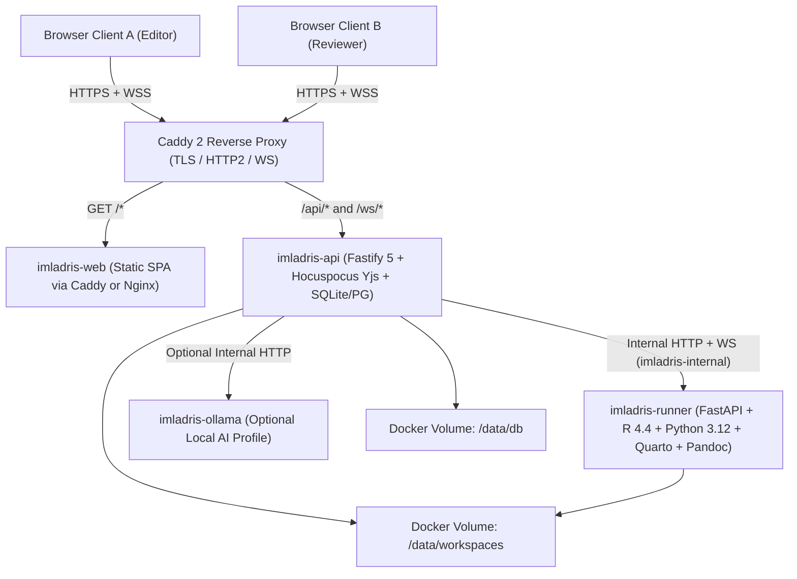
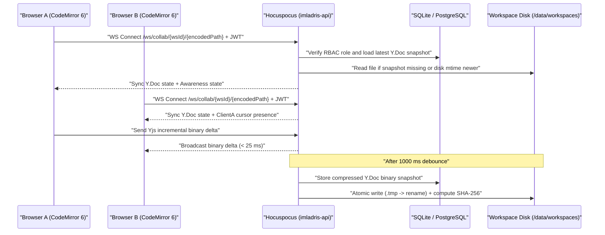
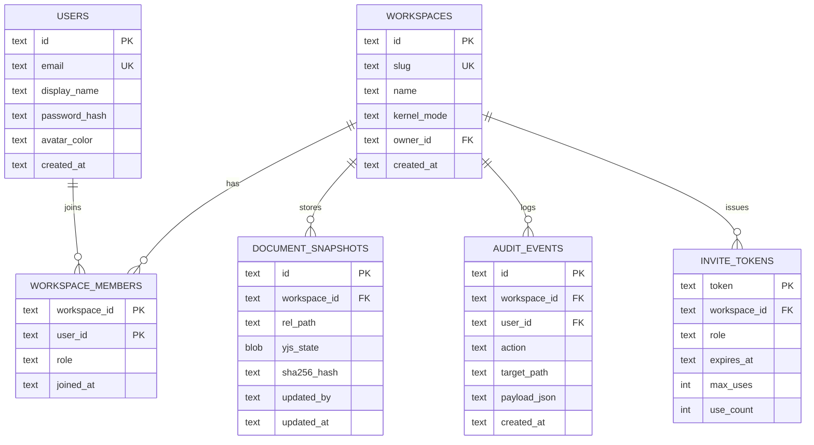

<!--
SPDX-FileCopyrightText: 2026 Antonio De Gaetano <antux912012@users.noreply.github.com>
SPDX-License-Identifier: Apache-2.0
-->

# Imladris on Web — Software Architecture and Build Plan (ASD-STE100)

- **Document Version:** `1.0.0`
- **Target Release:** `v0.1.0` (Sister Project of Native Imladris `v0.40.0`)
- **License Model:** `Apache-2.0` Hybrid Open-Core (Core Web Studio under `Apache-2.0`; Commercial Enterprise Pack for OIDC SSO, centralized GxP audit, and proprietary LIMS/ELN connectors)
- **Writing Standard:** ASD-STE100 (Simplified Technical English)
- **Target Execution Agent:** Gemini Hydrogen 4 Medium

---

## 1. Purpose and Scope

This document defines the complete software architecture and the step-by-step build plan for **Imladris on Web**.

Imladris on Web is the browser-based, Docker-deployable sister application of native **Imladris**. Users install Imladris on Web on a local workstation or on a remote Virtual Private Server (VPS). Multiple scientists open the same workspace in a web browser, edit documents at the same time without merge conflicts, run R and Python code in isolated containers, and export reproducible publications.

This document contains architecture and build instructions only. Do not modify native Imladris source files when you execute this plan.

---

## 2. Execution Protocol for Gemini Hydrogen 4 Medium

Follow these rules during every build phase:

1. Read only the files required for the current phase.
2. Execute phases strictly in order from **Phase 1** through **Phase 8**.
3. Follow every file path, schema, port, environment variable, and API route exactly as specified in this document.
4. Do not invent extra frameworks, extra microservices, or alternative ORMs.
5. Run the **Verification Gate** command at the end of each phase.
6. If a verification gate fails, fix all reported errors before you start the next phase.
7. Write all code in strict TypeScript (`strict: true`), Python 3.12 type hints, and validated JSON/YAML.
8. Add `SPDX-License-Identifier: Apache-2.0` to every new source file.

### Controlled Vocabulary (ASD-STE100 Glossary)

| Term | Exact Meaning in This Document |
| :--- | :--- |
| **Workspace** | One isolated project directory on disk with its own files, members, and optional R/Python sandbox. |
| **Document** | One text or notebook file inside a workspace (`.qmd`, `.Rmd`, `.ipynb`, `.md`, `.tex`, `.R`, `.py`, `.html`, `.rtf`). |
| **Y.Doc** | One Yjs Conflict-Free Replicated Data Type (CRDT) state instance that synchronizes edits across browsers. |
| **Collab Server** | The Hocuspocus WebSocket server inside `apps/api` that merges Y.Doc updates and saves files to disk. |
| **Runner** | The isolated `imladris-runner` Docker container that executes R, Python, Bash, Quarto, and Pandoc processes. |
| **Session** | One persistent R or Python Read-Eval-Print Loop (REPL) process inside the Runner. |
| **Presence** | Real-time collaborator state (display name, avatar color, active file, cursor offset, and selection range). |
| **Gate** | Mandatory automated test or build command that must return exit code `0` to close a phase. |

---

## 3. Feature Parity and Collaboration Matrix

| Capability | Native Imladris (`v0.40.0`) | Imladris on Web (`v0.1.0`) |
| :--- | :--- | :--- |
| **Deployment** | Flatpak / `.deb` / `.rpm` on Linux desktop | Docker Compose (`local` mode on `localhost:8080` or `vps` mode with automatic HTTPS) |
| **Editor Modes** | Focus Mode + 4-Quadrant Workbench | Focus Mode + 4-Quadrant Workbench in browser (`react-resizable-panels`) |
| **Real-Time Editing** | Single-user local buffer | Multi-user Yjs CRDT via WebSockets, live cursors, presence list, inline comments |
| **Autocompletion** | GtkSourceView 5 IntelliSense | CodeMirror 6 IntelliSense (Markdown/Quarto, LaTeX, HTML5, R, Python, Bash, live REPL columns) |
| **Quick Table Picker** | Cursor-anchored 8x8 popover (`Ctrl+Alt+T`) | Cursor-anchored 8x8 React popover (`Ctrl+Alt+T`) for Markdown, HTML, and LaTeX |
| **Compute Kernels** | Host/sandboxed R & Python REPL | Containerized `imladris-runner` persistent R & Python sessions (Shared or Personal mode) |
| **Live Preview** | WebKitGTK 6.0 / Cairo | Sandboxed `<iframe sandbox="allow-scripts">` with KaTeX, Mermaid.js, and scroll sync |
| **Project Formats** | `.qmd`, `.Rmd`, `.ipynb`, `.Rproj`, `.mallorn` | Full 1:1 round-trip compatibility with native Imladris files and `.mallorn` archives |
| **Elrond AI** | Local `llama-server`/Ollama + Cloud failover | Optional `ollama` Docker profile + opt-in Cloud API failover (`HTTP 429` cascade) |
| **Community Plugins** | `JSC.Context` + `registry.json` browser | Sandboxed Web Worker plugin host + shared `community-plugins/registry.json` browser |
| **GxP Provenance** | SHA-256 `<doc>.provenance.lock.json` | SHA-256 `<doc>.provenance.lock.json` plus collaborator audit log |

---

## 4. High-Level System Architecture

### 4.1 Container Topology Diagram



### 4.2 Architectural Rules

1. **Two Docker Networks**:
   - `imladris-edge`: Connects `proxy` (`caddy`), `imladris-web`, and `imladris-api`.
   - `imladris-internal` (`internal: true`): Connects `imladris-api`, `imladris-runner`, and optional `imladris-ollama`. The Runner has no direct inbound route from the public internet.
2. **Single Shared TypeScript Contract (`packages/shared`)**:
   - Both `apps/web` and `apps/api` import Zod schemas, `FormatProfile`, `ChunkParser`, and IntelliSense types from `packages/shared`.
3. **Filesystem as Source of Truth**:
   - Every workspace lives at `/data/workspaces/<workspaceId>/`.
   - Users can mount an existing native Imladris folder directly into `/data/workspaces/default/` on a local machine.
   - Collaborators edit in-memory Y.Docs. The Collab Server flushes Y.Doc text atomically (`.tmp` + `rename`) to disk every `1000 ms` of inactivity and on last client disconnect.
4. **Zero-Trust Execution Boundary**:
   - The browser never talks directly to `imladris-runner`.
   - `imladris-api` verifies the JWT cookie, checks the user role (`OWNER` or `EDITOR`), validates the workspace path, and proxies execution requests to `imladris-runner` using a shared internal bearer secret (`RUNNER_SHARED_SECRET`).

---

## 5. Collaborative Editing and Kernel Execution Flows

### 5.1 Real-Time Document Editing Sequence



### 5.2 Kernel Sharing Modes

Each workspace configures one of two execution modes:

1. **`SHARED` Mode (Default for Pair Science)**:
   - One persistent R session and one persistent Python session run per workspace (`session_key = ws:<workspaceId>`).
   - When Client A runs a chunk, `imladris-api` broadcasts stdout, plots, execution count, and updated environment variables to all connected workspace clients over `/ws/events/:workspaceId`.
2. **`PERSONAL` Mode (Default for Classrooms and Large Teams)**:
   - Each authenticated user gets isolated R and Python sessions (`session_key = ws:<workspaceId>:u:<userId>`).
   - Code edits remain collaborative in Y.Doc while variable state stays isolated per user.

---

## 6. Database Schema (SQLite Default / PostgreSQL Compatible)

Use Drizzle ORM with portable SQL definitions so local Docker uses SQLite (`/data/db/imladris.sqlite`) with zero setup, and VPS deployments can switch to PostgreSQL via `DATABASE_URL`.



### Role-Based Access Control (RBAC) Matrix

| Action | `OWNER` | `EDITOR` | `REVIEWER` | `VIEWER` |
| :--- | :---: | :---: | :---: | :---: |
| Read files, previews, plots, and outputs | Yes | Yes | Yes | Yes |
| Add inline Yjs comments | Yes | Yes | Yes | No |
| Edit documents via Yjs and upload files | Yes | Yes | No | No |
| Execute R / Python / Bash chunks | Yes | Yes | No | No |
| Export PDF / HTML / ODT / `.mallorn` | Yes | Yes | Yes | No |
| Create invites, change roles, delete workspace | Yes | No | No | No |

---

## 7. Repository Directory Layout

Create the sister repository at `/home/antonio/Projects/imladris-on-web` with this exact directory tree:

```text
imladris-on-web/
├── LICENSE                             # Apache-2.0
├── NOTICE                              # Hybrid Open-Core attribution
├── README.md                           # Quickstart for Local and VPS Docker
├── package.json                        # pnpm workspace root
├── pnpm-workspace.yaml                 # ["packages/*", "apps/*"]
├── tsconfig.base.json                  # Strict shared TS compiler options
├── .env.example                        # All documented environment variables
├── docker-compose.yml                  # Local Docker Compose (port 8080, SQLite)
├── docker-compose.vps.yml              # VPS production overlay (Caddy HTTPS, limits, optional PG/Ollama)
├── scripts/
│   └── install-web.sh                  # Interactive Local / VPS installer script
├── infra/
│   └── caddy/
│       └── Caddyfile                   # Reverse proxy + automatic TLS + WS upgrade
├── packages/
│   └── shared/
│       ├── package.json
│       ├── tsconfig.json
│       └── src/
│           ├── index.ts
│           ├── schemas.ts              # Zod API, WS, RBAC, and Manifest schemas
│           ├── format-profile.ts       # 1:1 port of Imladris FormatProfile
│           ├── chunk-parser.ts         # 1:1 port of Imladris ChunkParser
│           ├── notebook-codec.ts       # Lossless nbformat 4.5 .ipynb <-> .qmd codec
│           └── intellisense-engine.ts  # Port of CodeIntelliSenseEngine (MD/Quarto/HTML/LaTeX/R/Py/Bash)
├── apps/
│   ├── api/
│   │   ├── Dockerfile                  # Node 22 Alpine non-root image
│   │   ├── package.json
│   │   ├── tsconfig.json
│   │   └── src/
│   │       ├── server.ts               # Fastify bootstrap + graceful shutdown
│   │       ├── config.ts               # Strict Zod env parser
│   │       ├── db/
│   │       │   ├── schema.ts           # Drizzle tables (Section 6)
│   │       │   └── client.ts           # SQLite / PostgreSQL connection factory
│   │       ├── auth/
│   │       │   ├── password.ts         # Argon2id hash and verify
│   │       │   ├── jwt.ts              # HttpOnly JWT sign and verify
│   │       │   └── rbac.ts             # Fastify preHandler role guard
│   │       ├── routes/
│   │       │   ├── auth.ts             # /api/auth/*
│   │       │   ├── workspaces.ts       # /api/workspaces/* and /api/invites/*
│   │       │   ├── files.ts            # /api/workspaces/:id/files/* (safe realpath)
│   │       │   ├── execute.ts          # /api/workspaces/:id/execute and /env
│   │       │   ├── export.ts           # /api/workspaces/:id/export and .mallorn
│   │       │   ├── citations.ts        # /api/citations/doi and /arxiv
│   │       │   ├── ai.ts               # /api/ai/chat (Ollama + opt-in cloud failover)
│   │       │   └── plugins.ts          # /api/plugins/registry proxy + cache
│   │       ├── collab/
│   │       │   ├── hocuspocus.ts       # Yjs WS server + JWT auth + RBAC readOnly flag
│   │       │   └── disk-sync.ts        # Debounced atomic write-back + chokidar watcher
│   │       └── ws/
│   │           └── events.ts           # Workspace broadcast hub (REPL output, plots, env)
│   └── web/
│       ├── Dockerfile                  # Multi-stage Vite build -> Nginx/Caddy static
│       ├── package.json
│       ├── tsconfig.json
│       ├── vite.config.ts
│       ├── index.html
│       └── src/
│           ├── main.tsx
│           ├── App.tsx                 # Auth gate + Workspace router
│           ├── styles/
│           │   └── theme.css           # GNOME Adwaita light/dark/sepia + 9 accent tokens
│           ├── state/
│           │   ├── auth-store.ts
│           │   ├── workspace-store.ts
│           │   └── layout-store.ts     # Focus Mode vs 4-Quadrant persisted ratios
│           ├── components/
│           │   ├── HeaderBar.tsx       # Workspace switcher, presence avatars, share modal
│           │   ├── RibbonBar.tsx       # Home, Insert, Run, Publish, View, Packages
│           │   ├── WorkbenchLayout.tsx # Dual-mode Focus / 4-Quadrant resizable grid
│           │   ├── CollabEditor.tsx    # CodeMirror 6 + Yjs + IntelliSense + Chunk Run gutter
│           │   ├── TablePickerPopover.tsx # 8x8 hover grid + custom Rows/Cols (Ctrl+Alt+T)
│           │   ├── LivePreviewPane.tsx # Sandboxed iframe + KaTeX + Mermaid + scroll sync
│           │   ├── ConsolePane.tsx     # Interactive R/Python/Bash console + streamed stdout
│           │   ├── EnvironmentPane.tsx # Live R/Python variables + DataGrid modal
│           │   ├── FileTreePane.tsx    # Create, rename, upload, delete, .mallorn export
│           │   ├── CitationsPane.tsx   # BibTeX + DOI/arXiv resolver
│           │   ├── ElrondAiPane.tsx    # Chat + Direct Editor Writing (Yjs transaction)
│           │   ├── PluginBrowserModal.tsx # Community Plugins search + Web Worker loader
│           │   └── ShareWorkspaceModal.tsx # Invite links + RBAC member management
│           └── lib/
│               ├── api-client.ts
│               ├── collab-client.ts    # HocuspocusProvider + Awareness helpers
│               ├── cm-intellisense.ts  # CodeMirror 6 completion bridge to shared engine
│               └── preview-renderer.ts # Markdown/Quarto/HTML/LaTeX -> sandboxed HTML
└── services/
    └── runner/
        ├── Dockerfile                  # Debian slim + Python 3.12 + R 4.4 + Quarto + Pandoc (UID 10001)
        ├── requirements.txt            # fastapi, uvicorn, pydantic, httpx
        └── app/
            ├── main.py                 # Internal FastAPI app + shared secret middleware
            ├── sessions.py             # Persistent R & Python REPL manager (delimiter protocol)
            ├── inspector.py            # Live R/Python environment + DataFrame column probe
            ├── exporter.py             # Quarto / Pandoc / Typst / PDF / HTML / ODT / .mallorn
            ├── provenance.py           # SHA-256 GxP <doc>.provenance.lock.json generator
            └── security.py             # Strict workspace realpath boundary checker
```

---

## 8. API, WebSocket, and Environment Contracts

### 8.1 Environment Variables (`.env.example`)

| Variable | Default (Local) | VPS Production Requirement |
| :--- | :--- | :--- |
| `IMLADRIS_MODE` | `local` | `vps` |
| `AUTH_MODE` | `local` | `team` |
| `PUBLIC_URL` | `http://localhost:8080` | `https://lab.example.org` |
| `JWT_SECRET` | Auto-generated 64-hex | Mandatory 64-hex secret |
| `RUNNER_SHARED_SECRET` | Auto-generated 64-hex | Mandatory 64-hex secret |
| `DATABASE_URL` | `file:/data/db/imladris.sqlite` | `file:...` or `postgresql://...` |
| `WORKSPACES_ROOT` | `/data/workspaces` | `/data/workspaces` |
| `RUNNER_URL` | `http://runner:9000` | `http://runner:9000` |
| `RUNNER_EXEC_TIMEOUT_MS` | `60000` | `60000` |
| `AI_LOCAL_URL` | `http://ollama:11434` | Optional local Ollama or empty |
| `AI_ALLOW_CLOUD` | `false` | Opt-in `true` or `false` |

### 8.2 REST API Endpoints (`apps/api`)

- **Auth**:
  - `POST /api/auth/register` — Create user (Argon2id hash, issue HttpOnly JWT cookie).
  - `POST /api/auth/login` — Authenticate user and set HttpOnly JWT cookie.
  - `POST /api/auth/logout` — Clear JWT cookie.
  - `GET /api/auth/me` — Return active user profile and `AUTH_MODE`.
- **Workspaces & Invites**:
  - `GET /api/workspaces` — List workspaces where active user is a member.
  - `POST /api/workspaces` — Create workspace directory, DB record, and `OWNER` membership.
  - `PATCH /api/workspaces/:id` — Update workspace name or `kernel_mode` (`SHARED` / `PERSONAL`).
  - `POST /api/workspaces/:id/invites` — Create expiring invite token with role (`EDITOR`, `REVIEWER`, `VIEWER`).
  - `POST /api/invites/:token/accept` — Redeem invite token and add user to `workspace_members`.
- **Files**:
  - `GET /api/workspaces/:id/files` — Return recursive workspace file tree (excluding `.git`, `.venv`, `renv/library`).
  - `POST /api/workspaces/:id/files` — Create file or folder inside workspace.
  - `DELETE /api/workspaces/:id/files?path=<rel>` — Delete file or folder (requires `EDITOR` or `OWNER`).
  - `GET /api/workspaces/:id/snapshots?path=<rel>` — Return saved SHA-256 document revisions.
- **Execution & Environment**:
  - `POST /api/workspaces/:id/execute` — Body `{ engine: "r"|"python"|"bash", code: string, chunkId?: string }`. Proxies to Runner and broadcasts output/plots on `/ws/events/:id`.
  - `POST /api/workspaces/:id/restart-kernel` — Restart R and Python sessions for the workspace.
  - `GET /api/workspaces/:id/environment` — Return cached live R/Python variables, dimensions, and DataFrame column names (used by IntelliSense `$` and `.` completion).
- **Export, Citations, AI, and Plugins**:
  - `POST /api/workspaces/:id/export` — Export to `html`, `pdf`, `odt`, `rtf`, or `mallorn` and write `<doc>.provenance.lock.json`.
  - `GET /api/citations/resolve?id=<doi_or_arxiv>` — Resolve DOI or arXiv ID to BibTeX.
  - `POST /api/ai/chat` — Stream Elrond AI response from Ollama or configured cloud provider (`HTTP 429` failover).
  - `GET /api/plugins/registry` — Fetch and cache `community-plugins/registry.json` from `Antux912012/imladris`.

### 8.3 WebSocket Endpoints

1. `WS /ws/collab/:workspaceId/:encodedRelPath`:
   - Protocol: Hocuspocus / Yjs v1 binary sync + Awareness.
   - `onAuthenticate`: Verify JWT cookie, verify `workspace_members` row, set `connection.readOnly = true` when role is `VIEWER` or `REVIEWER`.
2. `WS /ws/events/:workspaceId`:
   - Protocol: JSON messages `{ type: "stdout" | "plot" | "env_updated" | "file_tree_changed" | "member_joined", payload: ... }`.

---

## 9. Docker Security and Deployment Specification

### 9.1 Local Installation (`docker-compose.yml`)

The local stack starts with one command:

```bash
docker compose up -d
```

- Exposes `http://localhost:8080` only on `127.0.0.1:8080` by default.
- Mounts `./workspaces:/data/workspaces` so users edit local files seamlessly with both native Imladris and Imladris on Web.
- Uses SQLite at `./data/db/imladris.sqlite`.

### 9.2 VPS Deployment (`docker-compose.vps.yml`)

The VPS stack starts with one command:

```bash
docker compose -f docker-compose.yml -f docker-compose.vps.yml up -d
```

- **Caddy 2** listens on ports `80` and `443` and provisions Let's Encrypt TLS certificates automatically for `${IMLADRIS_DOMAIN}`.
- **Runner Hardening**:
  - `user: "10001:10001"`
  - `cap_drop: ["ALL"]`
  - `security_opt: ["no-new-privileges:true"]`
  - `pids_limit: 256`
  - `mem_limit: 4g`
  - `cpus: "2.0"`
  - Attached to `imladris-internal` only (`internal: true`).
- **Optional Profiles**:
  - `--profile ollama`: Starts `ollama/ollama` on `imladris-internal` for 100% private local Elrond AI.
  - `--profile postgres`: Starts `postgres:16-alpine` for multi-team VPS scale.

---

## 10. Step-by-Step Build Plan (ASD-STE100 for Gemini Hydrogen 4 Medium)

Execute these 8 phases strictly in sequence. Complete every step and pass the phase Gate before moving forward.

---

### Phase 1 — Monorepo Skeleton and Shared Package (`packages/shared`)

**Objective:** Create the workspace root, TypeScript config, and shared scientific parsers/schemas.

1. Create `/home/antonio/Projects/imladris-on-web` and initialize Git with `LICENSE` (Apache-2.0), `NOTICE`, `package.json`, `pnpm-workspace.yaml`, and `tsconfig.base.json`.
2. Create `packages/shared/package.json` with `zod` and `vitest` dependencies.
3. Implement `packages/shared/src/schemas.ts` defining Zod schemas for `User`, `Workspace`, `Role`, `ExecuteRequest`, `ExecuteResponse`, `EnvVariable`, `ExportRequest`, and `CommunityPluginEntry`.
4. Implement `packages/shared/src/format-profile.ts` mapping `.qmd`, `.Rmd`, `.ipynb`, `.md`, `.tex`, `.R`, `.py`, `.ts`, `.html`, and `.rtf` to workbench layout mode (`focus` or `rstudio`), language ID, and citation style.
5. Implement `packages/shared/src/chunk-parser.ts` to parse fenced `{r}`, `{python}`, `{bash}`, `{ts}`, and `{mermaid}` code chunks with `#|` options.
6. Implement `packages/shared/src/notebook-codec.ts` for lossless `nbformat 4.5` `.ipynb` to Quarto Markdown round-trip conversion.
7. Implement `packages/shared/src/intellisense-engine.ts` porting the deterministic polyglot completion engine (Markdown/Quarto prose snippets, `@fig-`/`@tbl-`/`@sec-` cross-refs, HTML5 tags + smart `</tag>`, LaTeX macros, R `library()`/`fn(arg=)`/`df$col`/`pkg::fn`, Python `import`/`df.` methods, and Bash commands).
8. Write unit tests in `packages/shared/src/__tests__/shared.test.ts` covering all 5 modules.

**Phase 1 Verification Gate:**
```bash
pnpm --filter @imladris/shared typecheck && pnpm --filter @imladris/shared test
```
Pass condition: `0` TypeScript errors and all Vitest tests pass.

---

### Phase 2 — Database, Auth, RBAC, and Workspace API (`apps/api` Core)

**Objective:** Build the Fastify REST API with SQLite/PostgreSQL persistence, Argon2id auth, JWT cookies, and path-safe file CRUD.

1. Create `apps/api/package.json` (`fastify`, `@fastify/cookie`, `@fastify/cors`, `@fastify/websocket`, `drizzle-orm`, `better-sqlite3`, `argon2`, `jose`, `zod`).
2. Implement `apps/api/src/config.ts` to validate all environment variables from Section 8.1 and fail fast on missing secrets in `vps` mode.
3. Implement `apps/api/src/db/schema.ts` and `apps/api/src/db/client.ts` creating all 6 tables from Section 6 with automatic startup migration.
4. Implement `apps/api/src/auth/password.ts`, `apps/api/src/auth/jwt.ts`, and `apps/api/src/auth/rbac.ts`.
5. Implement `apps/api/src/routes/auth.ts` (`/register`, `/login`, `/logout`, `/me`) and automatic local-mode bootstrap user when `AUTH_MODE=local`.
6. Implement `apps/api/src/routes/workspaces.ts` (workspace CRUD, member list, expiring invite token generation, invite redemption).
7. Implement `apps/api/src/routes/files.ts` with a strict `resolveWorkspacePath(workspaceId, relPath)` guard that rejects `..`, symlinks escaping root, and absolute paths.
8. Write integration tests in `apps/api/src/__tests__/api-core.test.ts` testing registration, login, invite acceptance, RBAC `403` enforcement for `VIEWER`, and path-traversal rejection (`400`).

**Phase 2 Verification Gate:**
```bash
pnpm --filter @imladris/api typecheck && pnpm --filter @imladris/api test
```
Pass condition: All auth, RBAC, and path-security tests pass.

---

### Phase 3 — Real-Time Collaborative Editing Engine (`Hocuspocus` + `Yjs`)

**Objective:** Enable conflict-free multi-user editing with presence cursors, RBAC enforcement, SQLite snapshots, and atomic disk synchronization.

1. Add `@hocuspocus/server`, `yjs`, `chokidar`, and `@fastify/websocket` to `apps/api`.
2. Implement `apps/api/src/collab/disk-sync.ts`:
   - Write Y.Doc UTF-8 text atomically to `<target>.imladris.tmp` then `fs.rename` to `<target>`.
   - Compute SHA-256 hash and insert/update `document_snapshots`.
   - Watch `/data/workspaces` with `chokidar` and ignore self-writes via an in-memory recent-hash set.
3. Implement `apps/api/src/collab/hocuspocus.ts`:
   - Mount WebSocket route `/ws/collab/:workspaceId/:encodedRelPath`.
   - Authenticate every connection using the JWT cookie in `onAuthenticate`.
   - Set `connection.readOnly = true` for `VIEWER` and `REVIEWER` roles.
   - Load initial Y.Doc state from `document_snapshots` or seed from disk file if newer.
   - Persist snapshots and flush to disk in `onStoreDocument` (debounced `1000 ms`).
4. Implement `apps/api/src/ws/events.ts` to broadcast workspace events (`stdout`, `plot`, `env_updated`, `file_tree_changed`).
5. Write an automated two-client Yjs convergence test in `apps/api/src/__tests__/collab.test.ts`:
   - Connect Client A (`EDITOR`) and Client B (`EDITOR`) to the same document.
   - Apply concurrent inserts at index `0` and end of document.
   - Assert identical final Y.Doc text on both clients and on disk.
   - Connect Client C (`VIEWER`) and assert edits are rejected.

**Phase 3 Verification Gate:**
```bash
pnpm --filter @imladris/api test -- collab.test.ts
```
Pass condition: Two-client CRDT convergence, disk flush, and read-only `VIEWER` enforcement pass.

---

### Phase 4 — Isolated Scientific Execution Runner (`services/runner`)

**Objective:** Build the containerized Python 3.12 + R 4.4 + Quarto + Pandoc execution and export sidecar.

1. Create `services/runner/requirements.txt` (`fastapi`, `uvicorn[standard]`, `pydantic`, `pytest`, `httpx`).
2. Implement `services/runner/app/security.py` verifying internal header `X-Imladris-Runner-Secret` and enforcing `os.path.realpath` inside `/data/workspaces/<workspaceId>`.
3. Implement `services/runner/app/sessions.py`:
   - Maintain a dictionary of persistent `R` (`R --vanilla --quiet --no-save`) and `Python` (`python3 -u -i`) subprocesses keyed by `session_key`.
   - Use unique sentinel markers (`___IMLADRIS_END_<uuid>___`) and per-command timeouts (`RUNNER_EXEC_TIMEOUT_MS`).
   - Capture generated R/Matplotlib plots into `/data/workspaces/<workspaceId>/.imladris/plots/` and return relative plot paths.
4. Implement `services/runner/app/inspector.py` to return live R/Python variables, dimensions, DataFrame flags, and up to 80 column names per DataFrame.
5. Implement `services/runner/app/exporter.py` and `services/runner/app/provenance.py`:
   - Export `.qmd`/`.Rmd`/`.md`/`.tex`/`.ipynb` via `quarto` / `pandoc` to `html`, `pdf`, `odt`, and `rtf`.
   - Create and extract `.mallorn` zip archives with symlink and path-traversal checks.
   - Write `<document>.provenance.lock.json` containing SHA-256 hashes, timestamps, and collaborator user ID.
6. Wire `apps/api/src/routes/execute.ts` and `apps/api/src/routes/export.ts` to proxy authenticated requests to `RUNNER_URL` and broadcast outputs on `/ws/events/:workspaceId`.
7. Write pytest tests in `services/runner/tests/test_runner.py` testing persistent Python state across two calls, environment variable/column inspection, path-traversal denial, and provenance lockfile generation.

**Phase 4 Verification Gate:**
```bash
pytest services/runner/tests/test_runner.py
```
Pass condition: All Runner execution, inspection, security, and provenance tests pass.

---

### Phase 5 — Frontend Shell, Workbench Layout, and Collaborative Editor (`apps/web` Core)

**Objective:** Build the React + Vite frontend with GNOME Adwaita theming, Focus/4-Quadrant dual mode, CodeMirror 6 + Yjs collaboration, IntelliSense, and Quick Table Picker.

1. Initialize `apps/web` with React 19, TypeScript 5, Vite 6, Tailwind CSS v4, `react-resizable-panels`, `lucide-react`, `codemirror`, `@codemirror/lang-markdown`, `@codemirror/lang-python`, `@codemirror/lang-html`, `@codemirror/autocomplete`, `yjs`, `y-codemirror.next`, and `@hocuspocus/provider`.
2. Create `apps/web/src/styles/theme.css` implementing Light, Dark, and Eye-Friendly Sepia themes plus 9 GNOME accent tokens.
3. Build `HeaderBar.tsx` (workspace selector, collaborator avatar stack showing active users from Yjs Awareness, Focus/4-Quadrant toggle, Share button) and `RibbonBar.tsx` (Home, Insert, Run, Publish, View, Packages).
4. Build `WorkbenchLayout.tsx` switching automatically between Focus Mode and 4-Quadrant Workbench based on `FormatProfile.fromFilename(path)`.
5. Build `CollabEditor.tsx`:
   - Bind CodeMirror 6 to `HocuspocusProvider` (`yCollab(ytext, provider.awareness)`).
   - Render remote collaborator carets with username labels and colors.
   - Add chunk gutter **Run** buttons on every fenced `{r}`, `{python}`, and `{bash}` header.
   - Connect `cm-intellisense.ts` to `@imladris/shared`'s `queryCompletions()` merged with live `/environment` columns.
6. Build `TablePickerPopover.tsx` (8x8 hover grid + custom Rows/Cols inputs, `Ctrl+Alt+T` shortcut, format-aware Markdown/HTML/LaTeX insertion).
7. Build `ShareWorkspaceModal.tsx` to generate copyable invite links by role (`EDITOR`, `REVIEWER`, `VIEWER`).

**Phase 5 Verification Gate:**
```bash
pnpm --filter @imladris/web typecheck && pnpm --filter @imladris/web build
```
Pass condition: `0` TypeScript errors and clean Vite production bundle.

---

### Phase 6 — Live Preview, Console, Environment, Citations, Elrond AI, and Community Plugins

**Objective:** Complete all scientific studio quadrants and browser extensions.

1. Build `LivePreviewPane.tsx` rendering Markdown/Quarto/HTML/LaTeX via `preview-renderer.ts` inside `<iframe sandbox="allow-scripts">` with bundled **KaTeX** and **Mermaid.js**, plus proportional editor-to-preview scroll sync.
2. Build `ConsolePane.tsx` subscribing to `/ws/events/:workspaceId` to display live R/Python/Bash inputs, streamed stdout/stderr, and inline plot thumbnails.
3. Build `EnvironmentPane.tsx` showing live DataFrames, Values, and Functions with a sortable/filterable DataGrid preview modal.
4. Build `FileTreePane.tsx` (create/rename/delete/upload files, `.mallorn` export/import) and `CitationsPane.tsx` (DOI/arXiv lookup via `/api/citations/resolve` + `@citekey` insertion).
5. Build `ElrondAiPane.tsx` and `apps/api/src/routes/ai.ts`:
   - Connect to local `AI_LOCAL_URL` (Ollama) by default.
   - Support opt-in cloud provider failover (`HTTP 429` cascade).
   - Apply **Direct Editor Writing** edits as a single Yjs transaction so `Ctrl+Z` reverts in one step and all collaborators see the update live.
6. Build `PluginBrowserModal.tsx` and `apps/api/src/routes/plugins.ts`:
   - Fetch and search `https://raw.githubusercontent.com/Antux912012/imladris/main/community-plugins/registry.json`.
   - Execute installed JavaScript plugins inside a sandboxed browser **Web Worker** exposing the `imladris.*` message bridge (`ui.showToast`, `editor.getText`, `editor.insertAtCursor`, `repl.runR`, `repl.runPython`).

**Phase 6 Verification Gate:**
```bash
pnpm --filter @imladris/web typecheck && pnpm --filter @imladris/web build && pnpm --filter @imladris/api test
```
Pass condition: Full frontend bundle succeeds and all API tests pass.

---

### Phase 7 — Dockerization, Local & VPS Compose Stacks, and Installer Script

**Objective:** Package the complete system for 1-command local and VPS deployment.

1. Write `services/runner/Dockerfile`:
   - Base: `debian:bookworm-slim`.
   - Install `python3`, `python3-venv`, `r-base`, `pandoc`, `quarto`, `curl`, `git`, and non-root user `imladris` (UID `10001`).
   - Add `HEALTHCHECK` calling `http://127.0.0.1:9000/health`.
2. Write `apps/api/Dockerfile`:
   - Multi-stage `node:22-alpine` build compiling `packages/shared` and `apps/api`.
   - Run as non-root `node` user with `HEALTHCHECK` calling `http://127.0.0.1:3001/health`.
3. Write `apps/web/Dockerfile`:
   - Multi-stage `node:22-alpine` Vite build copied into `caddy:2-alpine` serving `/srv` on port `8080`.
4. Write `infra/caddy/Caddyfile` routing:
   - `/api/*` and `/ws/*` -> `reverse_proxy api:3001` (with WebSocket headers preserved).
   - `/*` -> static SPA files with `try_files {path} /index.html`.
5. Write `docker-compose.yml` (Local Mode) and `docker-compose.vps.yml` (VPS HTTPS overlay + resource limits + optional `ollama` and `postgres` profiles) matching Section 9.
6. Write `scripts/install-web.sh`:
   - Generate cryptographically random `JWT_SECRET` and `RUNNER_SHARED_SECRET` into `.env`.
   - Support `--mode local` (starts `http://localhost:8080`) and `--mode vps --domain <fqdn>` (configures Caddy TLS on `443`).

**Phase 7 Verification Gate:**
```bash
docker compose config -q && docker compose -f docker-compose.yml -f docker-compose.vps.yml config -q && docker compose build
```
Pass condition: Both Compose configs validate with `0` errors and all 3 Docker images build cleanly.

---

### Phase 8 — End-to-End Smoke Verification and Documentation

**Objective:** Verify the running Docker stack end to end and publish clear operator documentation.

1. Start the local Docker stack (`docker compose up -d`) and verify all container healthchecks reach `healthy`.
2. Run an automated end-to-end smoke script (`scripts/e2e-smoke.sh`) that verifies:
   - User registration and login return `200` with HttpOnly JWT cookie.
   - Workspace creation creates `/data/workspaces/<id>`.
   - Two simultaneous WebSocket clients converge on a `.qmd` edit and flush to disk.
   - `POST /api/workspaces/:id/execute` runs an R expression (`mean(mtcars$mpg)`) and a Python expression (`2 + 2`) and returns expected stdout.
   - `POST /api/workspaces/:id/export` generates HTML output and `<doc>.provenance.lock.json` with a valid SHA-256 digest.
   - `docker compose down` stops all containers cleanly with zero orphan processes.
3. Complete `README.md` with Local quickstart (`3` commands), VPS deployment with automatic HTTPS (`3` commands), backup/restore commands for `/data/workspaces` and `/data/db`, and troubleshooting notes.

**Phase 8 Verification Gate:**
```bash
docker compose up -d && bash scripts/e2e-smoke.sh && docker compose down
```
Pass condition: All smoke assertions pass with exit code `0`.

---

## 11. Definition of Done

Imladris on Web `v0.1.0` is complete when all 8 Phase Verification Gates return exit code `0` and all conditions below are true:

1. A user runs `docker compose up -d` locally and opens a working 4-Quadrant workbench at `http://localhost:8080`.
2. An administrator runs `scripts/install-web.sh --mode vps --domain <fqdn>` on a Linux VPS and gets automatic HTTPS with team login and invite links.
3. Two or more browsers edit the same `.qmd` / `.Rmd` / `.md` file simultaneously with visible cursors, zero conflicts, and atomic saves to disk.
4. R, Python, and Bash code chunks run exclusively inside the unprivileged, network-isolated `imladris-runner` container.
5. Every file carries `SPDX-License-Identifier: Apache-2.0`, and zero secrets are committed to Git.
